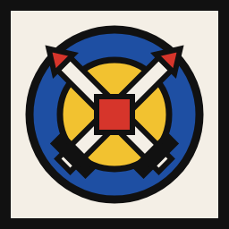
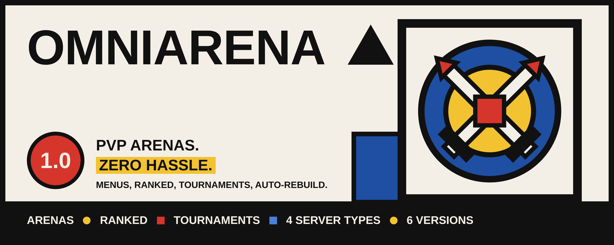
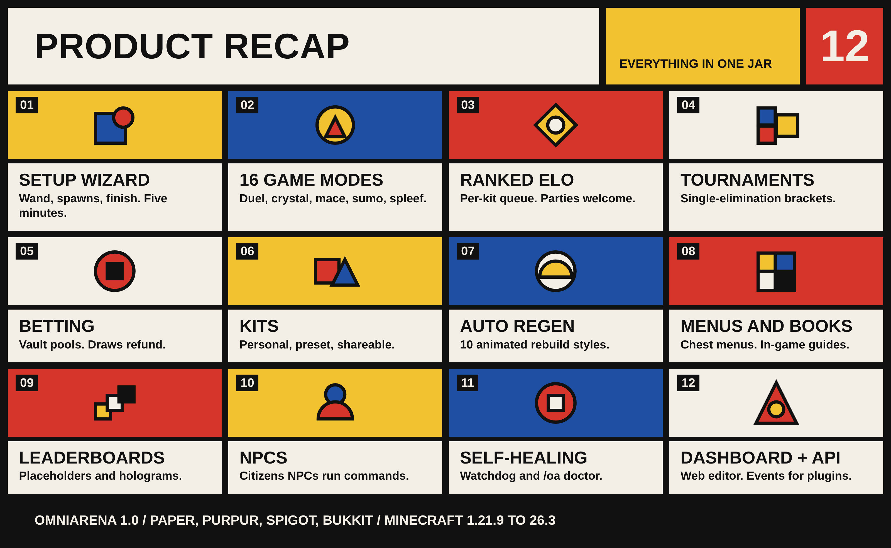
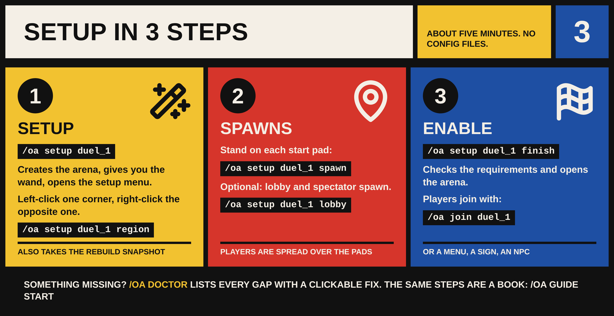
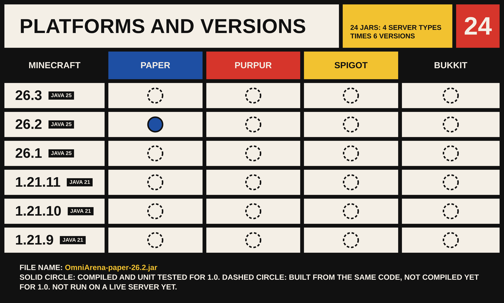

<p align="center"></p>



# OmniArena

**A PvP arena plugin for Paper, Purpur, Spigot and Bukkit (Minecraft 1.21.9 to 26.3) that sets up in five minutes and looks after itself.**

Players join arenas from a menu, a command or a sign and fight in *16 game types*. Admins build an arena with a short
wizard; the plugin rebuilds it after every match and repairs itself when something goes wrong.

> **Honest status.** Version 1.0.0. The unit tests pass (pure logic only); only the Paper 26.2 jar has been compiled for 1.0, the other 23 are not compiled yet.
> The six Purpur jars could not be verified (their repository was unreachable). ***It has never been run on a live
> server.*** The DecentHolograms, FancyHolograms, Citizens and Multiverse hooks are reflection-only and untested.
> Try it on a copy of your server first. Details: [Status](#status).

**Modrinth page:** *link follows after the first upload.* | **Full reference:** [DOCS.md](DOCS.md) | **In game:** `/oa guide`



---

## Feature highlights

### Play

- **Menu first.** `/oa` opens a main menu; setup, editing, kits and settings are button menus, and every action also has a
  text command with tab completion. Typos get a did-you-mean with a clickable fix.
- **16 game types:** Deathmatch, Team Deathmatch, Last One Standing, Sumo, Classic PvP, Crystal PvP, Mace, Sword Duel, Axe and
  Shield, UHC, Potion PvP, NoDebuff, Archer, Netherite OP, Spleef, Gladiator. Plus lives, teams, respawn waves, spectating,
  join signs, per-arena rules, whitelist and blacklist.
- **Ranked.** Per-kit queues, ELO and party-aware matchmaking. **Tournaments** (single elimination) and **betting** (Vault).
- **Kits.** Personal kits with sharing, preset kits with cooldowns and permissions, a power cap.
- **PvP management** server-wide: combat tag, PvP toggle, newbie and respawn protection, anti kill-abuse.

### Run

- **Automatic regeneration.** Every arena is rebuilt from a snapshot after each match, with 10 animated styles.
- **Self-healing.** Config repair with backups, automatic migration of old configs, a watchdog for stuck arenas and tasks,
  and `/oa doctor`.
- **Leaderboards without built-in holograms.** PlaceholderAPI placeholders for everything, plus ready-made leaderboards for
  DecentHolograms and FancyHolograms, Citizens NPCs, Multiverse world loading and TAB support.
- **Guide books** in game (`/oa guide`), a **web dashboard**, an **event API** for other plugins, and an animated console
  banner (`general.startup-banner: full | compact | off`).



---

## Quick install

1. Pick the jar for your server and version: `OmniArena-<platform>-<mcversion>.jar` with platform `paper`, `purpur`, `spigot`
   or `bukkit` and version `26.3`, `26.2`, `26.1`, `1.21.11`, `1.21.10` or `1.21.9` (Java 25 for 26.x, Java 21 for 1.21.x).
   `paper` and `purpur` jars need a Paper-family server; `spigot` and `bukkit` jars run on Spigot, Bukkit and Paper.
2. Put it in `plugins/` and restart. Optional, detected automatically: Vault with an economy plugin, PlaceholderAPI,
   WorldGuard, LuckPerms, DecentHolograms or FancyHolograms, Citizens, Multiverse-Core, TAB.
3. Everything is stored in `plugins/OmniArena/`. Old configs are migrated automatically (a backup goes to `backups/`).

## Quick start (admins, about 5 minutes)

1. `/oa setup duel_1`: creates the arena, gives you the selection wand and opens the setup menu.
2. Build the arena, then left-click one corner and right-click the opposite corner with the wand, and run
   `/oa setup duel_1 region` (this also takes the rebuild snapshot).
3. Stand on each start pad and run `/oa setup duel_1 spawn`.
4. `/oa setup duel_1 finish` enables the arena. Players join with `/oa join duel_1`, from `/oa menu`, or a sign
   (`/oa sign create duel_1`).

`/oa guide start` has the same steps as a clickable book; `/oa doctor` checks that nothing is missing.

---

## Commands

Root command `/oa` (aliases `/arena`, `/omniarena`); `/oa` alone opens the menu. `/oa help` lists everything.

| Player command | What it does |
|----------------|--------------|
| `/oa menu` | Main menu |
| `/oa join [arena]`, `/oa leave`, `/oa spectate [arena]` | Join (no name opens a picker), leave, watch (`/join`, `/leave`, `/spectate` also work) |
| `/oa list [arena]` | Arenas, or details of one |
| `/oa stats [player]`, `/oa stats top [kills/wins/kd/elo] [n]` | Stats, ELO, rank, leaderboards |
| `/oa queue [kit]`, `queue leave`, `queue status` | Ranked matchmaking |
| `/oa bet place/cancel/info`, `/oa tournament ...` | Betting and tournaments (`/bet`, `/tournament`) |
| `/oa guide [topic]` | In-game guide books |
| `/party ...`, `/kit ...`, `/pvp` | Parties, personal kits, PvP toggle and status |

| Admin command | What it does |
|---------------|--------------|
| `/oa setup <arena> [region/lobby/spectator/spawn/clearspawns/finish]` | Create and set up an arena |
| `/oa edit <arena> [set/get <key> [value]]`, `whitelist`, `blacklist` | Edit menu or text editing, access lists |
| `/oa arena tp/delete/enable/disable <arena>` | Per-arena actions |
| `/oa regen <arena>`, `/oa regen snapshot <arena>` | Rebuild, re-snapshot |
| `/oa kits [action]` | Preset kits |
| `/oa sign create/remove/list`, `/oa leaderboard ...`, `/oa npc ...` | Signs, leaderboard holograms, Citizens NPCs |
| `/oa settings`, `/oa reload`, `/oa web`, `/oa doctor [fix]` | Settings, reload, dashboard, health |
| `/oa plugin start/stop/restart/version` | Lifecycle |
| `/pvp tag/untag/global/list/override` | Admin PvP |

Permissions: players need nothing special (`omniarena.use`, `omniarena.kit.use`, `omniarena.queue`, `omniarena.bet`,
`omniarena.spectate`, `omniarena.pvp`, `omniarena.tournament.create` default to true). Admin commands need `omniarena.admin` or a
specific node such as `omniarena.admin.arena`. The full list is in [DOCS.md](DOCS.md#4-permissions).

## Placeholders

With PlaceholderAPI: `%omniarena_kills%`, `_deaths`, `_wins`, `_losses`, `_kd`, `_winrate`, `_elo`, `_rank`, `_in_match`, `_arena`,
`_gamemode_name`, `_state`, `_alive`, `_time_left`, `_team`, and leaderboards
`%omniarena_top_<kills/wins/kd/elo>_<1-10>_name%` / `_value%`. The complete list is in
[DOCS.md](DOCS.md#6-placeholders). `integrations.tab.takeover: true` hands the scoreboard and boss bar to TAB.

## Configuration

`plugins/OmniArena/config.yml` (layout version 2) is grouped into `general`, `arenas`, `matches`, `regen`, `ranked`, `kits`,
`rewards`, `betting`, `tournaments`, `pvp`, `visuals`, `integrations`, `web`, `health` and `advanced`, with every default and
allowed value in a comment. Change values with `/oa settings`, in the web dashboard, or in the file and `/oa reload`. The
reference and the old-to-new key table for migrated files are in [DOCS.md](DOCS.md#5-configuration-reference).

## Web dashboard

`/oa web` prints a login link. It listens on `127.0.0.1:8123` (this machine only). For remote use put it behind an HTTPS reverse
proxy and set `web.public-url`; never expose the plain port. Tabs: dashboard, live matches, arenas, players, config and docs.

## For developers

Events (`ArenaPlayerJoinEvent` (cancellable), `ArenaPlayerLeaveEvent`, `ArenaMatchStartEvent`, `ArenaMatchEndEvent`,
`ArenaKillEvent`) and the `OmniArenaAPI` facade are described in [DOCS.md](DOCS.md#9-event-api-for-developers).

## Building

Maven 3.9+ and a JDK matching the target. Always pass one platform profile and one version profile:

```bash
mvn -q -Ppaper,mc-26.2 package            # target/OmniArena-paper-26.2.jar
mvn -q -Ppaper,mc-26.2 test               # unit tests
JAVA25_HOME=/path/to/jdk25 JAVA21_HOME=/path/to/jdk21 scripts/build-all.sh   # all 24 jars into dist/
```

Profiles: `paper`, `purpur`, `spigot`, `bukkit` x `mc-26.3`, `mc-26.2`, `mc-26.1`, `mc-1.21.11`, `mc-1.21.10`, `mc-1.21.9`.
Only the paper/26.2 jar has been compiled for 1.0; the other 23 use the same code but are not compiled yet,
and there are no automated tests against a live server. Details: [DOCS.md](DOCS.md#12-building).

## Troubleshooting

| Symptom | Fix |
|---------|-----|
| Something looks stuck or broken | Run `/oa doctor`; `/oa doctor fix` repairs stuck arenas, orphaned players and stopped tasks |
| "OmniArena is stopped" | `/oa plugin start` (the only command that works while stopped) |
| Cannot join an arena | The message names the reason (disabled, no spawn, full, whitelist, world not loaded, being rebuilt). Admins get the fix as a clickable command |
| Arena does not rebuild | It needs a region and a snapshot: `/oa setup <arena> region` or `/oa regen snapshot <arena>`; `/oa doctor` lists arenas without one |
| Plugin disables itself on start | Wrong jar flavor (paper/purpur need a Paper-family server), Minecraft version or Java version |
| Leaderboard placeholders blank | PlaceholderAPI missing, or no matches played yet |
| Config change has no effect | Run `/oa reload`; only `web.*` and `advanced.web.*` need a restart |

## Known limitations

Everything is stored as YAML (no database). Regeneration snapshots that contain containers are not portable between paper/purpur
and spigot/bukkit jars (re-take them with `/oa regen snapshot <arena>`), and blocking the elytra firework boost while
combat-tagged works only on paper/purpur. See [DOCS.md](DOCS.md#13-known-limitations).

---

## Status

***Version 1.0.0.*** Unit tests (`mvn -q -Ppaper,mc-26.2 test`) cover pure logic only. Compilation is verified for the paper,
spigot and bukkit jars; the six Purpur jars could not be verified. There are no tests against a live server, and nobody has
run the plugin on one yet. Please report problems with the console log and the output of `/oa doctor`.



*Modrinth page text and graphics sources: [docs/modrinth/](docs/modrinth/).*
