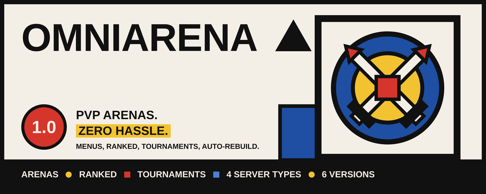
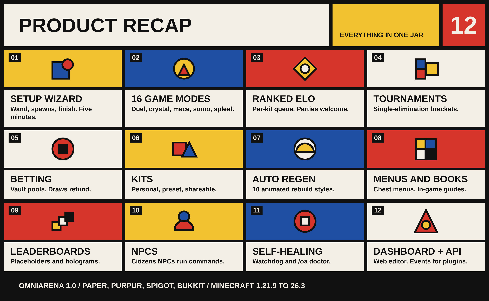
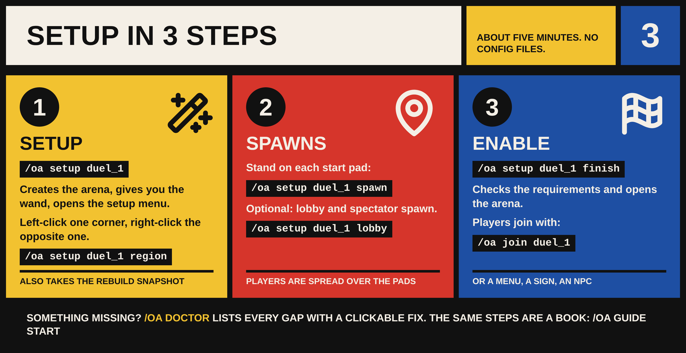
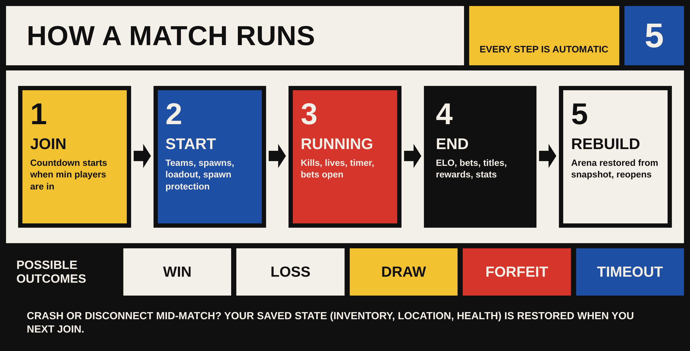
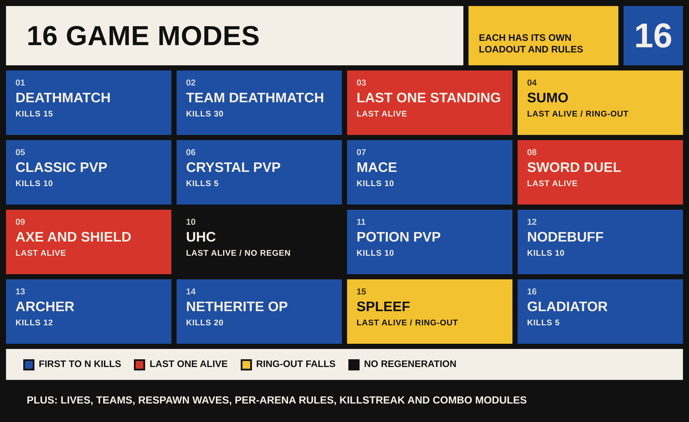
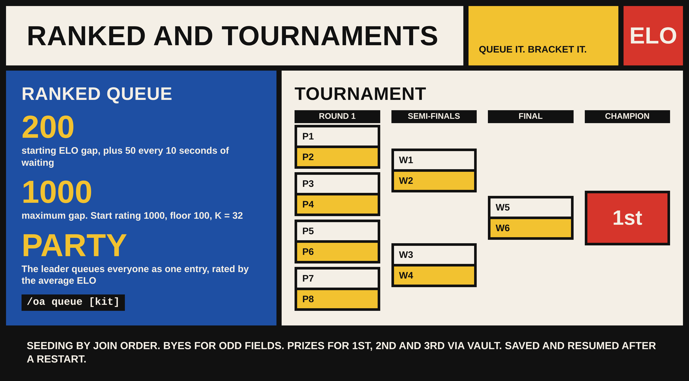
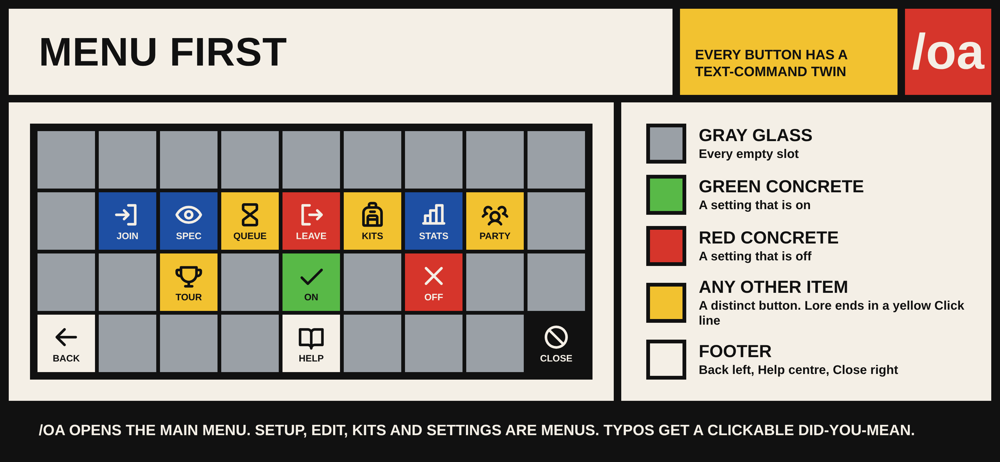
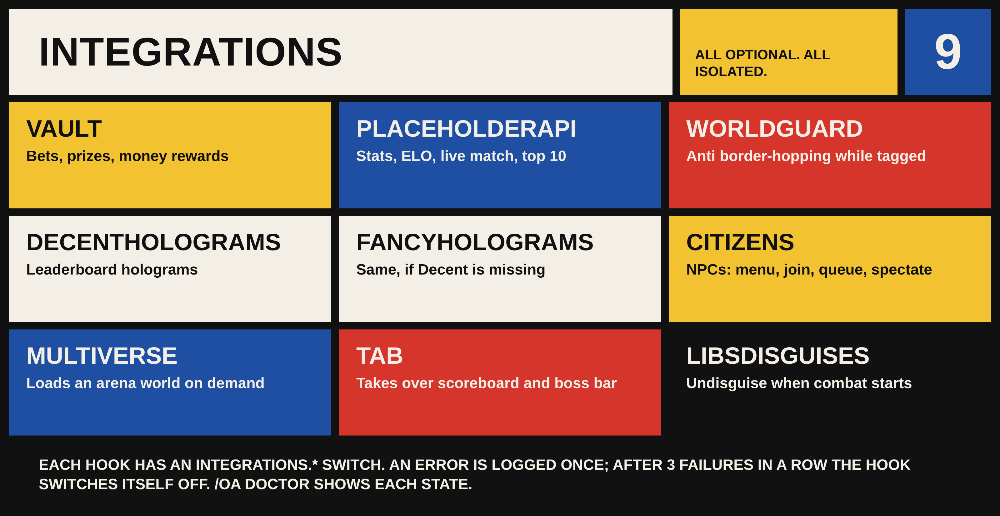
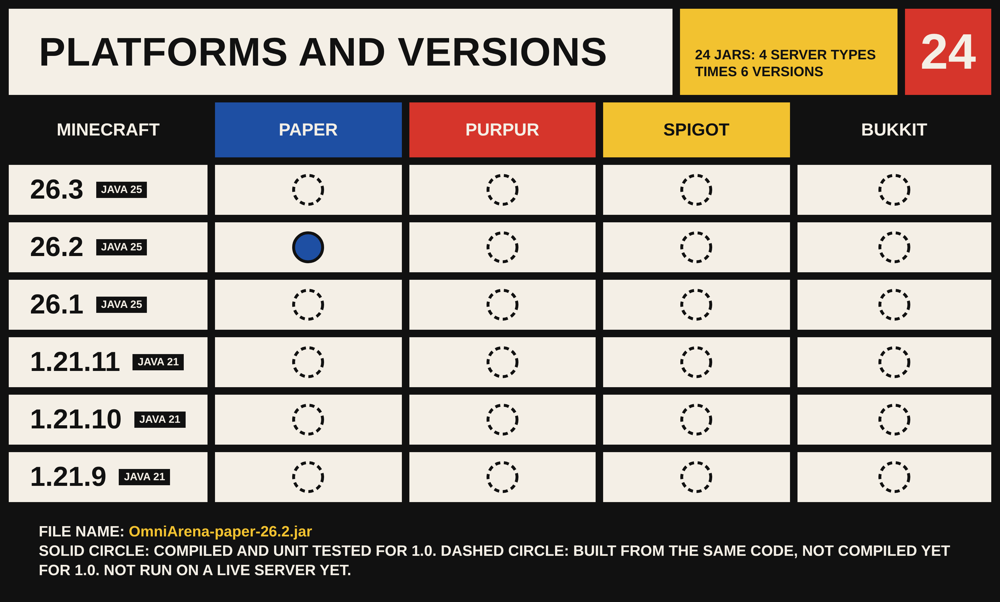

**OmniArena is a PvP arena plugin that sets up in five minutes and looks after itself.** Players join from a menu, a command or a sign and fight in 16 game types. Admins build an arena with a short wizard, and the plugin rebuilds it after every match.

> **Please read the honest status first.** Version 1.0.0 has passing unit tests (they cover pure logic only), but only the **Paper 26.2** jar has been compiled for 1.0; the other 23 jars (Purpur, Spigot, Bukkit and the other Minecraft versions) use the same code but have not been compiled yet. **Nobody has run OmniArena on a live server yet.** The links to DecentHolograms, FancyHolograms, Citizens and Multiverse use reflection and are untested against the real plugins. Please try it on a copy of your server first. Details: [Honest status](#honest-status).


# Summary

- **16 game types.** Deathmatch, Sumo, Crystal PvP, Mace, UHC, Spleef and more, with lives, teams and respawn waves.
- **Fast setup.** A wizard with a wand, spawn pads and one `finish` command.
- **Auto regeneration.** Every arena is rebuilt after each match, with 10 animated styles.
- **Ranked.** Per-kit queues, ELO, parties.
- **Tournaments and betting.** Single-elimination brackets, Vault prizes and bet pools.
- **Menu first.** Chest menus for everything. Every button also has a text command.
- **In-game guides.** Books you open with `/oa guide`.
- **Leaderboards.** PlaceholderAPI placeholders and ready-made holograms.
- **Self-healing.** Config repair, a watchdog and `/oa doctor`.
- **For developers.** A web dashboard and an event API.



# Quick start

## Install

1. Download the jar for your server type and Minecraft version: `OmniArena-<platform>-<mcversion>.jar`.
2. Put it in `plugins/` and restart.
3. Optional and detected automatically: Vault, PlaceholderAPI, WorldGuard, LuckPerms, DecentHolograms or FancyHolograms, Citizens, Multiverse-Core, TAB.

Use **Java 25** for 26.x servers and **Java 21** for 1.21.x servers. Everything is stored as YAML in `plugins/OmniArena/`.

## Your first arena



```
/oa setup duel_1            creates the arena, gives you the wand
(wand: left-click one corner, right-click the opposite corner)
/oa setup duel_1 region     saves the region and takes the rebuild snapshot
/oa setup duel_1 spawn      run on each start pad
/oa setup duel_1 finish     checks everything and enables the arena
```

Then players type `/oa join duel_1`, use `/oa menu`, or click a sign (`/oa sign create duel_1`).

> *Tip:* run `/oa doctor` at any time. It lists what is missing, with a clickable fix.

# Features

## Arenas and matches



- **Lobby and countdown.** The countdown starts when enough players are in. A lobby with too few players closes after a timeout you can set.
- **Lives, teams, respawn waves.** Lives work in every game type. Teams need the arena's `team-enabled` flag. Respawn types are instant, delayed and wave.
- **Spectating.** Players watch with `/oa spectate`.
- **Per-arena rules.** Chat mode, announcements, modules (killstreak, combo, power-ups), whitelist and blacklist.
- **State is saved.** Location, inventory, health, effects and more are restored when a player leaves. This also works after a crash.
- **Outcomes.** Win, loss, draw, forfeit and timeout.

## Automatic regeneration

After every played match the arena is rebuilt from a snapshot. It stays closed until the rebuild is done.

| Style | How it rebuilds |
|---|---|
| `SPHERE` (default) | From the centre outwards |
| `INSTANT` | Batched placement |
| `RISE` / `FALL` | Bottom to top, top to bottom |
| `SWEEP` | A plane across the arena |
| `TIME_REWIND` | Undoes the changes of the match in reverse |
| `GALAXY` | Four spiral arms |
| `HOLOGRAM_SCAN` | Glass preview, then real blocks |
| `METEOR_SHOWER` | Random impacts |
| `OVERGROWTH` | A flood fill from a few seeds |

Large jobs are spread over many ticks, so the server keeps running smoothly.

## Kits and PvP management

- **Personal kits** with `/kit`: save, equip, rename, preview and share a kit with another player. Slots depend on permissions. An optional power cap removes overpowered enchants and banned items.
- **Preset kits** for admins with `/oa kits`: ten defaults (warrior, archer, tank and more), cooldowns and permissions.
- **Server-wide PvP.** Combat tag, a PvP toggle, newbie protection, respawn protection and anti kill-abuse.

# Game modes



Set a mode with `/oa edit <arena> set game-mode <TYPE>` or in the edit menu.

| Type | Goal |
|---|---|
| Deathmatch, Team Deathmatch | First to N kills (default 15 and 30) |
| Classic PvP, Mace, Potion PvP, NoDebuff | First to 10 kills |
| Crystal PvP, Gladiator | First to 5 kills |
| Archer | First to 12 kills |
| Netherite OP | First to 20 kills |
| Last One Standing, Sword Duel, Axe and Shield | Last player alive |
| Sumo, Spleef | Last alive, and falling out counts as a death |
| UHC | Last alive, with no natural regeneration |

***Good to know:*** kill targets are defaults. An arena can override the goal or the target.

# Ranked and tournaments



## Ranked queue

`/oa queue [kit]` joins the queue (`queue leave` and `queue status` do what they say). A matchmaking task runs every second. It pairs players by ELO. The allowed gap starts at **200** and grows by **50 every 10 seconds** of waiting, up to **1000**. A party leader queues the whole party as one entry. Only ranked matches change ELO (start 1000, floor 100, K = 32).

## Tournaments

`/oa tournament create <name> <arena> <max>` starts a registration. It begins automatically when full, or when the creator runs `start`. Brackets are single elimination, one match at a time per arena. Prizes for 1st, 2nd and 3rd are paid through Vault. Tournaments are saved and resume after a restart. Tournament matches are not ranked.

## Betting

With Vault and an economy plugin, players can bet on a participant of a live match: `/oa bet place <arena> <player> <amount>`. Winners share the pool in proportion to their bets. **With a draw, or if nobody bet on the winner, every bet is refunded.**

# Menus



`/oa` opens the main menu. Setup, editing, kits and settings are chest menus too. The design is the same everywhere: empty slots are gray glass, **green concrete means on**, **red concrete means off**, and every other button is its own item with a yellow "Click ..." line. Back, Help and Close sit in the bottom row.

> Every menu action has a text command twin with tab completion. A typo gets a did-you-mean with a clickable fix.

# Guides

`/oa guide` opens a book with clickable topics. Players see **play, kits, ranked, tournament, betting, pvp**. Admins also see **start, arena, regen, leaderboards, npc, doctor, config**. The text is in `plugins/OmniArena/guides.yml`, so you can edit it.

# Integrations and placeholders



| Plugin | What OmniArena does |
|---|---|
| Vault | Economy for bets, prizes and money rewards |
| PlaceholderAPI | The `omniarena` expansion |
| WorldGuard | Anti border-hopping while combat-tagged |
| DecentHolograms, FancyHolograms | `/oa leaderboard` holograms |
| Citizens | `/oa npc`: NPCs that open the menu, join, queue or spectate |
| Multiverse-Core | Loads an arena's world on demand |
| TAB | `integrations.tab.takeover: true` hands the scoreboard and boss bar to TAB |
| LibsDisguises | Removes a disguise when combat starts |
| LuckPerms | Hook only. No feature uses it yet |

Every hook has a switch (`integrations.<name>`). A hook that fails three times in a row switches itself off, and `/oa doctor` shows its state.

## Placeholders

```
%omniarena_kills%  %omniarena_wins%  %omniarena_kd%  %omniarena_elo%  %omniarena_rank%
%omniarena_arena%  %omniarena_state%  %omniarena_alive%  %omniarena_time_left%
%omniarena_top_<kills|wins|kd|elo>_<1-10>_<name|value>%
```

The full list is in the [documentation](https://github.com/JasonPieterK/OmniArena/blob/main/DOCS.md#6-placeholders). Leaderboard values come from a cache that refreshes about every 30 seconds. OmniArena has **no built-in holograms**. It uses placeholders and the two hologram plugins above.

# Self-healing

- **Config repair.** Missing keys are filled in, wrong values get their default, and a broken file is replaced. A backup goes to `backups/` first. Old config layouts are migrated automatically.
- **Quarantine.** A corrupt data file is moved to `broken/` and the plugin continues.
- **Watchdog.** Every 30 seconds by default. It frees stuck arenas, restores players whose match vanished and restarts stopped tasks.
- **Error guard.** An error in one task or listener is logged once and does not stop the rest.
- **`/oa doctor`** prints a report. `/oa doctor fix` runs every fix now.

# Commands

Root command: `/oa` (aliases `/arena`, `/omniarena`). `/oa help` lists everything.

| Command | What it does |
|---|---|
| `/oa menu` | Main menu |
| `/oa join [arena]`, `/oa leave`, `/oa spectate [arena]` | Join, leave, watch (`/join`, `/leave`, `/spectate` work too) |
| `/oa list [arena]` | Arenas, or details of one |
| `/oa stats [player]`, `/oa stats top [kills/wins/kd/elo] [n]` | Stats, ELO, rank, leaderboards |
| `/oa queue [kit]` | Ranked queue |
| `/oa bet ...`, `/oa tournament ...` | Betting and tournaments (`/bet`, `/tournament`) |
| `/oa guide [topic]` | Guide books |
| `/party ...`, `/kit ...`, `/pvp` | Parties, personal kits, PvP toggle |
| `/oa setup <arena> ...` | Arena wizard (admin) |
| `/oa edit <arena> [set/get <key> [value]]` | Edit menu or text edit (admin) |
| `/oa arena tp/delete/enable/disable <arena>` | Arena actions (admin) |
| `/oa regen <arena>`, `/oa regen snapshot <arena>` | Rebuild, re-snapshot (admin) |
| `/oa kits`, `/oa sign`, `/oa leaderboard`, `/oa npc` | Preset kits, signs, holograms, NPCs (admin) |
| `/oa settings`, `/oa reload`, `/oa web`, `/oa doctor` | Settings, reload, dashboard, health (admin) |
| `/oa plugin start/stop/restart/version` | Lifecycle (admin) |

# Permissions

Players need nothing special. These nodes default to **true**: `omniarena.use`, `omniarena.kit.use`, `omniarena.queue`, `omniarena.bet`, `omniarena.spectate`, `omniarena.pvp`, `omniarena.tournament.create`. Admin commands need `omniarena.admin` or a narrower node such as `omniarena.admin.arena`, `.kit`, `.sign`, `.npc`, `.leaderboard`, `.stats`, `.reload` or `.doctor`. Extra kit slots: `omniarena.kit.slots.5` and `omniarena.kit.slots.10`.

# Config highlights

`plugins/OmniArena/config.yml` has these sections: `general`, `arenas`, `matches`, `regen`, `ranked`, `kits`, `rewards`, `betting`, `tournaments`, `pvp`, `visuals`, `integrations`, `web`, `health` and `advanced`. Every key has its default and allowed values in a comment.

| Key | Default | What it does |
|---|---|---|
| `arenas.countdown` | `10` | Lobby countdown in seconds |
| `arenas.match-duration` | `600` | Match length in seconds |
| `matches.lobby-timeout` | `120` | Close a lobby below the minimum players after this long |
| `regen.style` | `SPHERE` | Rebuild animation |
| `betting.min-bet` / `max-bet` | `100` / `10000` | Bet limits |
| `general.startup-banner` | `full` | `full`, `compact` or `off` |

Change values with `/oa settings`, in the web dashboard, or in the file and `/oa reload`.

## Web dashboard

`/oa web` prints a login link. The dashboard listens on `127.0.0.1:8123` by default, so only the machine itself can open it. For remote use, put it behind an HTTPS reverse proxy. Tabs: dashboard, live matches, arenas, players, config and docs.

## Event API

Other plugins can listen to `ArenaPlayerJoinEvent` (cancellable), `ArenaPlayerLeaveEvent`, `ArenaMatchStartEvent`, `ArenaMatchEndEvent` and `ArenaKillEvent`, and call the `OmniArenaAPI` facade.

# Supported platforms



| Platform | Notes |
|---|---|
| Paper, Purpur | Need a Paper-family server |
| Spigot, Bukkit | Run on Spigot, Bukkit and also on Paper |

Versions: **26.3, 26.2, 26.1** (Java 25) and **1.21.11, 1.21.10, 1.21.9** (Java 21). That makes 24 jars named `OmniArena-<platform>-<mcversion>.jar`. A paper or purpur jar on a non-Paper server disables itself with a message.

## Honest status

- **Unit tests pass.** They test pure logic only (brackets, config migration, menus layout, guide pages and more).
- **Compiled:** only the Paper 26.2 jar so far. The other 23 jars are not compiled yet for 1.0.
- **Not verified:** the six Purpur jars (repository unreachable at the time).
- **Never run on a live server.** There are no automated tests against a real server.
- **Untested hooks:** DecentHolograms, FancyHolograms, Citizens and Multiverse (reflection only).
- **Known limits:** all data is YAML. Snapshots with containers are not portable between paper/purpur and spigot/bukkit jars. Blocking the elytra boost while tagged only works on paper/purpur.

If something breaks, run `/oa doctor` and open an issue with the console log.

# FAQ

**Which jar do I need?**
Pick your server type and Minecraft version, for example `OmniArena-paper-26.2.jar`. If unsure, the spigot jar runs on Spigot, Bukkit and Paper.

**Do I need Vault?**
Only for bets, tournament prizes and money rewards. Everything else works without it.

**Is the arena rebuilt by itself?**
Yes. Take the snapshot once with `/oa setup <arena> region`. After that every played match is followed by an automatic rebuild.

**Can I turn off the animated startup banner?**
Yes: `general.startup-banner: off`. Panels and plain consoles get a static banner anyway.

**Can I change the guide books?**
Yes. Edit `plugins/OmniArena/guides.yml`, then run `/oa reload`.

**Does it use a database?**
No. All data is YAML.

**My old config uses the old layout.**
It is migrated automatically, and a backup goes to `backups/`.

# Links

- **Documentation:** [DOCS.md](https://github.com/JasonPieterK/OmniArena/blob/main/DOCS.md)
- **Source and issues:** [GitHub](https://github.com/JasonPieterK/OmniArena)
- **In game:** `/oa guide`


